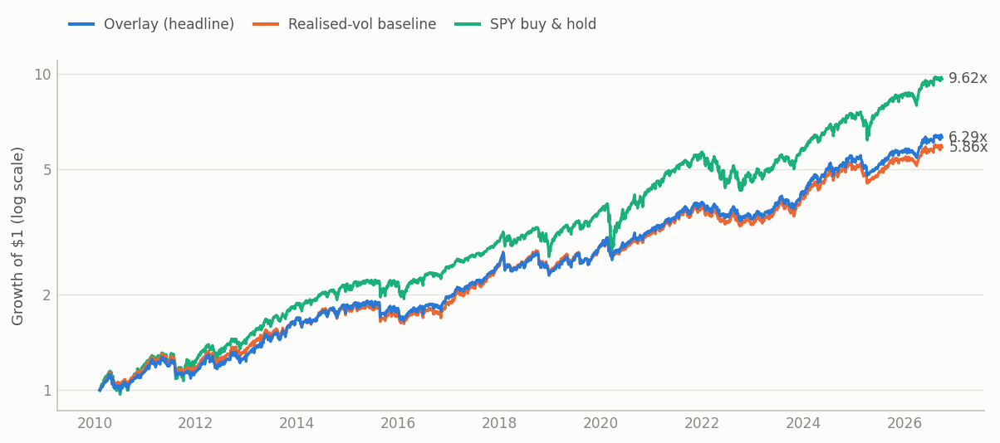
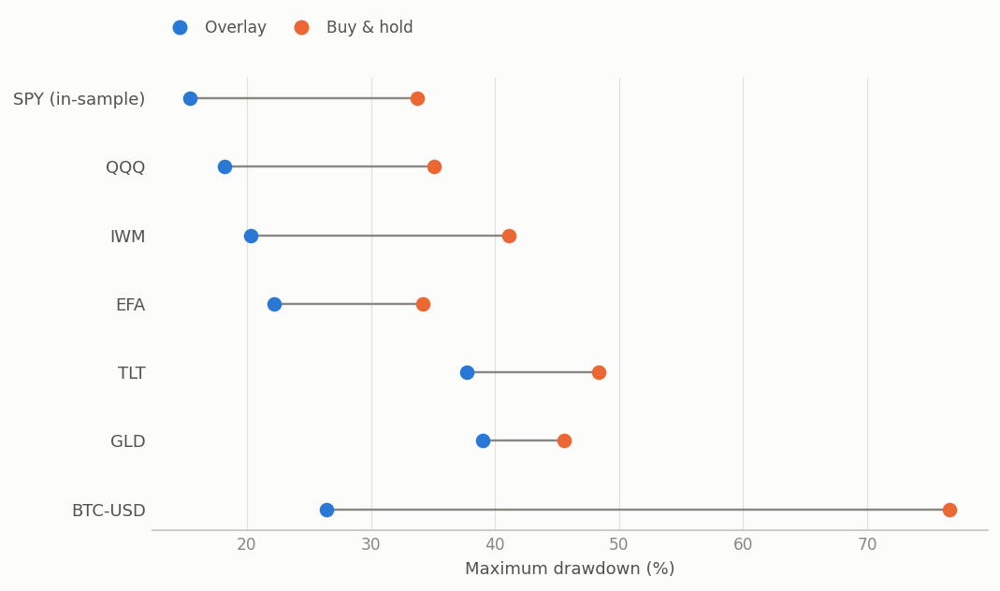
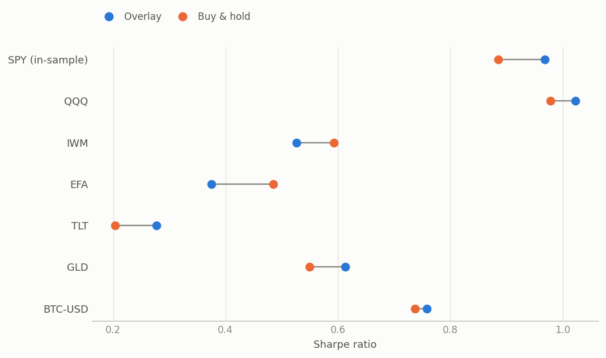
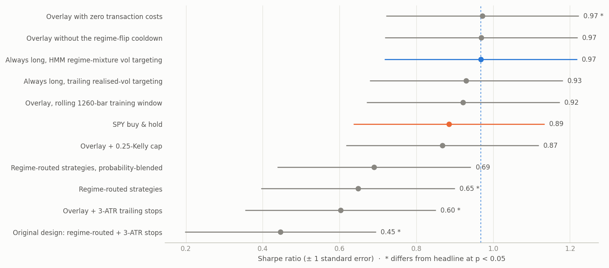
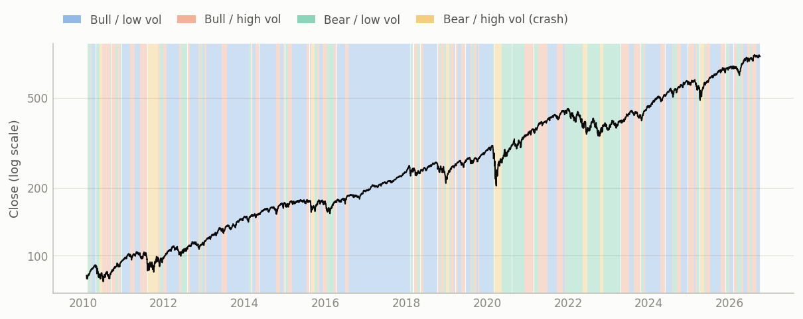

# Regime Engine

[](https://github.com/AbdelKharij/regime-engine/actions/workflows/ci.yml)


A regime-switching trading and risk engine built from scratch in Python. It combines:
* a walk-forward **4-state Gaussian hidden Markov model**, written in NumPy and verified
  against `hmmlearn`
* a regime-aware sizing and risk desk
* an **event-driven backtester** with realistic execution
* an ablation study with formal significance tests
* a **pre-registered out-of-sample test** on six assets never used during development

**Finding: the HMM's regimes classify volatility, not direction.** Used to pick direction,
they significantly destroy value (on SPY and on all six held-out assets). Used to forecast
volatility for position sizing, they cut the maximum drawdown on all seven assets tested.
They trade far less than realised-volatility sizing, with no statistically significant
change in Sharpe ratio. → [Research note](docs/RESEARCH_NOTE.md)



## Results

### SPY: in sample for design decisions

Walk-forward from **2010-02-03 to 2026-09-30**. The first model is fit on 2005–2010. All
figures are after spread, square-root market impact and commission, with next-open fills.

| | Overlay (headline) | Realised-vol baseline | SPY buy & hold |
|---|---:|---:|---:|
| CAGR | 11.6% | 11.1% | 14.6% |
| Volatility | 12.1% | 12.1% | 17.0% |
| Sharpe (± SE) | **0.97 ± 0.25** | 0.93 ± 0.25 | 0.89 ± 0.25 |
| Max drawdown | **15.4%** | 15.5% | 33.7% |
| Turnover (×/yr) | 3.5 | 5.8 | – |
| Total costs | $24k | $39k | – |

**The overlay:** always long, sized daily to a 12% volatility target using the HMM's
regime-mixture volatility forecast for the next bar, behind a risk desk (VaR budget,
drawdown breaker, a cooldown after each regime flip).

### Out of sample: six unseen assets, pre-registered

The hypotheses, pass/fail rules, frozen config and analysis script were committed **before**
the run ([`0f2d61b`](docs/OUT_OF_SAMPLE.md)). The run happened once, with no changes
afterwards. Full protocol and results: [docs/OUT_OF_SAMPLE.md](docs/OUT_OF_SAMPLE.md).

| Hypothesis (from SPY) | QQQ | IWM | EFA | TLT | GLD | BTC | Verdict |
|---|:-:|:-:|:-:|:-:|:-:|:-:|---|
| Overlay drawdown < buy & hold | ✓ | ✓ | ✓ | ✓ | ✓ | ✓ | **replicates** |
| Overlay trades less than realised-vol sizing | ✓ | ✓ | ✓ | ✓ | ✓ | ✓ | **replicates** |
| HMM sizing not worse than realised-vol sizing | ✓ | ✓ | ✓ | ✓ | ✓ | ✓ | **replicates** |
| Regime-routed direction signals hurt | ✓ | ✓ | ✓ | ✓ | ✓ | ✓ | **replicates** |
| Overlay Sharpe > buy & hold | ✓ | ✗ | ✗ | ✓ | ✓ | ✓ | partially |
| Overlay deflated Sharpe > 0.95 | ✓ | ✗ | ✗ | ✗ | ✗ | ✗ | **fails** |

<p align="center">
  
  
</p>

The risk claims generalise: lower drawdown on every asset, and 26–65% less turnover than
realised-vol sizing. The return claim does not: no overlay-vs-buy-and-hold Sharpe difference
is significant on any asset (p from 0.27 to 0.87). This matches the literature on
volatility-managed portfolios (Cederburg et al. 2020). One SPY design choice failed to
transfer: trailing stops, harmful on SPY, *helped* on gold and Bitcoin.

### Ablation: what each layer contributes (SPY)



| Variant | Sharpe | Max DD | ΔSharpe vs headline | p |
|---|---:|---:|---:|---:|
| **Overlay (headline)** | **0.97** | 15.4% | – | – |
| Realised-vol sizing (no HMM) | 0.93 | 15.5% | −0.04 | 0.27 |
| + 0.25-Kelly cap | 0.87 | 15.8% | −0.10 | 0.18 |
| + 3-ATR trailing stops | 0.60 | 21.5% | **−0.37** | **0.02** |
| Rolling (vs expanding) training window | 0.92 | 16.9% | −0.05 | 0.47 |
| Regime-routed strategies | 0.65 | 12.4% | **−0.32** | **0.03** |
| Original design: regime-routed + stops | 0.45 | 11.5% | **−0.52** | **0.01** |
| SPY buy & hold | 0.89 | 33.7% | −0.09 | 0.43 |

The p-values come from a paired stationary bootstrap (Politis & Romano 1994), which keeps
serial dependence. The deflated Sharpe ratio counts all nine configurations tried, including
the losers.

## Why direction fails and sizing works



| Diagnostic (SPY 2010–2026, causal) | Result |
|---|---|
| Causal regime vs. ex-post smoothed regime | 83% agreement |
| Decoded regime vs. *realised* next-21-day regime | 32% agreement (chance ≈ 25%) |
| SPY return after a confirmed bear/high-vol regime | +38% annualised |

The model identifies the *current* volatility state well but says little about the next
month's direction. Detection lags the drawdown, and the rebound follows. Volatility, by
contrast, is persistent and forecastable, so scaling exposure by the regime forecast keeps
risk roughly constant. The HMM's forecast also moves more smoothly than realised volatility,
so it trades less.

## How it works

```
OHLCV ──► DataIngestor ──► FeatureEngine ──► HMMEngine (walk-forward) ──► RegimeState(t)
          validate,         log return,        Baum-Welch refit every 21 bars
          never repair      Parkinson vol,     on an expanding window, label
                            volume-change vol  mapping, filtered P(S_t|x_1..t),
                                               hysteresis
                                                   │
          ┌────────────────────────────────────────┘
          ▼
   StrategyAgent ──► Sizer ──► RiskManager ──► ExecutionSimulator ──► Portfolio
   direction only    regime-     DD breaker,     next-open fills,       cash/shares,
   (default: long)   mixture     cooldown, VaR   spread + sqrt impact   borrow
                     vol target  budget (FHS),   + commission
                                 leverage, stops
```

* **HMM from scratch.** Scaled forward/backward recursions, Baum-Welch with k-means++
  restarts, a covariance ridge, an optional sticky prior, Viterbi, sampling and BIC. It is
  verified against brute-force path enumeration and against `hmmlearn` (likelihood,
  posteriors, Viterbi path and Baum-Welch updates, all to 1e-8).
* **Label switching solved.** After every refit, states are ranked by de-scaled mean return
  and then volatility, and **all** parameters are permuted together. A Hungarian-assignment
  cross-check and an anomaly log channel flag economically doubtful labellings.
* **Strictly causal.** Decisions use only filtered probabilities, and scalers are fit inside
  each training window. Fills happen no earlier than the next bar.
* **Risk desk.** Regime-mixture, historical, parametric and filtered-historical-simulation
  VaR/ES, with Kupiec and Christoffersen backtests. Also a drawdown circuit breaker,
  reduce-only cooldowns, gap-aware ATR stops, and a per-rule audit trail on every decision.
* **Analytics.** Sharpe with a non-normal standard error, Probabilistic and Deflated Sharpe,
  paired bootstrap tests, drawdown episodes, regime confusion matrices and attribution, all
  rendered into a single-file HTML tear sheet ([SPY](reports/spy_tear_sheet.html),
  [out of sample](reports/oos/)).

## Verification

252 tests, 95% line coverage (CI fails below 90%), `mypy --strict`, and `ruff`, all run on
Python 3.10–3.12. The tests that matter most:

* **Look-ahead canary, whole stack.** Every bar after a cutoff T is corrupted, and the full
  pipeline reruns from raw prices through features, HMM refits, strategy, risk and execution.
  Equity, positions and cash up to T must be **bit-identical**. The same checker catches
  centred windows, forward-shifted labels, full-sample scaling, back-filled data and
  single-ULP tampering.
* **Two independent accounting engines.** The event-driven cash/share ledger and a
  return-space recursion agree to **~1e-15** over hundreds of orders, including shorts and
  borrow.
* **Calibrated statistics.** PSR is uniform under the null. The expected-max-Sharpe formula
  matches Monte Carlo. Kupiec matches an independent binomial likelihood ratio. Mixture VaR
  matches a 1-million-draw simulation.
* **Recovery.** On 5,000 bars simulated from a known 4-regime model, EM recovers the
  per-state moments and decodes the true state on more than 90% of bars.

## Quickstart

```bash
make install     # venv + package with dev and data extras
make check       # ruff, mypy --strict, pytest with coverage
make report      # SPY ablation + tear sheet + README figures (~3 min)
make oos         # the pre-registered out-of-sample study
```

Or directly: `regime-engine backtest --config config/spy_daily.toml`. Every run saves its
tables plus a `manifest.json` (config fingerprint, data hash, package versions) and a
JSON-lines event log.

## Limitations

* **Small sample.** Seven assets and about 16 years are a small sample for Sharpe inference.
  Standard errors (≈0.25) are larger than most differences in the tables.
* **Design choices came from SPY.** The overlay headline, Kelly cap off and stops off were
  chosen after seeing SPY results. The pre-registered out-of-sample test is the check on
  that, and one of those choices (stops off) did not transfer.
* **Fixed K = 4.** It is required by the 2×2 regime taxonomy, but BIC prefers K = 5 on SPY.
* **Single-asset portfolios.** The natural next step is cross-asset risk allocation.
* **Execution model.** Fractional shares, cash earns no interest, and impact is calibrated
  heuristically.

## Documentation

* [Research note](docs/RESEARCH_NOTE.md): the question, method, results and references
* [Out-of-sample protocol and results](docs/OUT_OF_SAMPLE.md)
* [Architecture](docs/ARCHITECTURE.md): design, maths, class blueprints, and the decision &
  findings log (§13)
